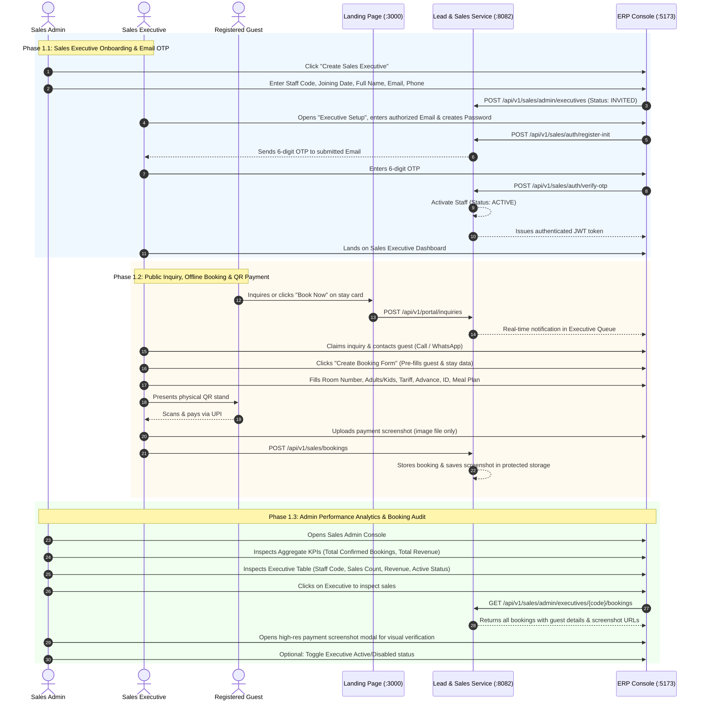

# Phase 1 Master Plan: Sales Executive & Sales Admin ERP

**Document Version:** 1.0.0  
**Phase:** Phase 1 – Requirement Discovery & Frontline Sales Delivery  
**Target Delivery:** Two-Role Sales CRM & Booking Verification System  
**Roles:** `Sales Executive` (`SALES_EXEC`) & `Sales Admin` (`SALES_ADMIN`)  

---

## 1. Executive Summary & Scope Reset

### 1.1 Why the Plan Changed
Previous drafts and prototypes included early implementations of resort-wide hotel operations (reception room board, housekeeping task board, billing folios, and ops consoles). These modules were premature, did not satisfy current business needs, and added unnecessary operational complexity.

### 1.2 The New Phase 1 Scope
Phase 1 is now **100% focused on Frontline Lead Conversion and Sales Operations**:
- **Frontline Execution:** Empower Sales Executives to quickly claim guest inquiries from the public website, contact prospective guests, fill an official booking form, accept offline UPI payments via a physical QR stand, and upload payment screenshots.
- **Management Oversight:** Provide the Sales Admin with total visibility over team performance (revenue generated, booking counts), the ability to provision and deactivate sales staff, and a deep-dive audit viewer to inspect customer records and verify payment screenshots.
- **Strict Role Boundary:** Only two roles exist in the user-facing app: **Sales Executive** and **Sales Admin**.

### 1.3 Archival Safety Strategy (Git)
To ensure no previous code or reference logic is lost:
1. All existing code, styles, and prototypes will be preserved in a dedicated locked Git branch: `archive/hotel-draft`.
2. The active working branch (`main`) will be cleaned up so that Phase 1 represents a clean, lightweight, highly focused Sales CRM.
3. Any utility or layout logic from the archive can be referenced or cherry-picked in future phases.

---

## 2. End-to-End System Workflow



---

## 3. Role 1: Sales Executive (`SALES_EXEC`)

### 3.1 Onboarding & Authentication Flow
- **Pre-authorization Requirement:** No random user can register as a Sales Executive. The email must be pre-authorized by the Sales Admin.
- **Self-Service Password & OTP Activation:**
  1. The executive visits the ERP login page and selects **"Set up executive account"**.
  2. Enters their **authorized email** and their **new password**.
  3. System checks that the email exists in `sales_staff` with status `INVITED`.
  4. System generates a secure **6-digit numeric OTP** (valid for 10 minutes) and sends it to that email.
  5. The executive inputs the OTP into the web interface.
  6. Upon successful verification:
     - Password hash is saved (BCrypt).
     - Account status changes from `INVITED` to `ACTIVE`.
     - System logs the executive in and opens the Sales Executive Dashboard.

### 3.2 Lead Management & Inquiry Pickup
- Receives inbound guest inquiries submitted from the public landing page.
- Inquiry cards display: Guest Name, Mobile Number, Email, Room Category Requested, Tentative Check-in/Check-out Dates, and Guest Notes.
- Action: **"Claim Inquiry"** assigns the lead to that executive and locks out other reps.

### 3.3 The Booking Form Flow
When the guest confirms interest, the executive clicks **"Create Booking Form"**.

#### Form Fields Specification:
| Field Name | Type | Source / Entry | Description |
|---|---|---|---|
| **Guest Name** | Text | Pre-filled | Customer's full name from inquiry |
| **Phone Number** | Phone | Pre-filled | Customer's contact number |
| **Email Address** | Email | Pre-filled | Customer's email |
| **Room Category** | Dropdown | Pre-filled / Editable | e.g., Luxury Pool Villa, Heritage Cottage |
| **Room Number** | Text | **Executive Enters** | Specific room allocated (e.g. `Villa 104`) |
| **Check-in Date** | Date | Pre-filled / Editable | Arrival date |
| **Check-out Date** | Date | Pre-filled / Editable | Departure date |
| **Adults Count** | Number | **Executive Enters** | Number of adult guests (1+) |
| **Children Count** | Number | **Executive Enters** | Number of children (0+) |
| **Total Tariff (₹)** | Currency | **Executive Enters** | Final agreed package price (e.g. ₹25,000) |
| **Advance Paid (₹)** | Currency | **Executive Enters** | Amount collected via QR (e.g. ₹10,000) |
| **Guest ID Type** | Dropdown | **Executive Enters** | Aadhaar Card, Passport, Driving License |
| **Guest ID Number** | Text | **Executive Enters** | Government ID number of the primary guest |
| **Meal Plan** | Radio / Select | **Executive Enters** | **EP** (Room Only), **CP** (Breakfast), **AP** (All Meals) |
| **Special Requests** | Textarea | **Executive Enters** | Honeymoon setup, extra bed, dietary notes |

### 3.4 Offline QR Payment & Screenshot Upload
- **Payment Method:** The executive presents their **physical QR code stand** (UPI / PhonePe / GPay / Paytm).
- **Payment Execution:** Guest scans the physical stand and transfers the advance/full amount.
- **Zero Manual UTR Typing:** To eliminate friction and typos, the executive does **not** type UTR numbers or transaction timestamps.
- **Screenshot Proof:** Executive captures/receives the payment confirmation screen and uploads the image (`.png`, `.jpg`, `.jpeg`, `.webp`).
- **Submission:** Submitting the form writes the booking record and securely stores the image.

---

## 4. Role 2: Sales Admin (`SALES_ADMIN`)

### 4.1 Executive Provisioning
The Sales Admin has exclusive authority to create Sales Executives.
- Clicking **"Create Sales Executive"** opens a dedicated modal:
  1. **Staff Code** (e.g., `GH-SE-001`, `GH-SE-002`) — Unique identifier.
  2. **Date of Joining** (Calendar date).
  3. **Full Name** (e.g., `Rahul Sharma`).
  4. **Email Address** (e.g., `rahul.sharma@goldenhills.in`).
  5. **Mobile Number** (e.g., `+91 98765 43210`).
- On submit: Record created in `sales_staff` with status `INVITED`.

### 4.2 Executive Status Management (Active / Deactivated)
- Admin can toggle any executive between **Active** and **Disabled**.
- Disabled executives cannot log in, claim inquiries, or create bookings.

### 4.3 Sales Analytics Dashboard
The Admin console provides an executive performance overview:
- **Aggregate KPI Cards:**
  - **Total Bookings Confirmed:** All completed bookings across all executives.
  - **Total Revenue Collected (₹):** Cumulative value of advance and total tariffs.
  - **Active Sales Executives:** Count of staff currently active.
  - **Pending Leads:** Unclaimed or in-progress inquiries in the pipeline.
- **Executive Performance Table:**
  | Staff Code | Name | Joining Date | Phone | Bookings Confirmed | Total Revenue (₹) | Status | Actions |
  |---|---|---|---|---|---|---|---|
  | `GH-SE-001` | Rahul Sharma | 2026-11-01 | +91 98765... | 14 | ₹3,45,000 | Active | [View Bookings] [Toggle] |
  | `GH-SE-002` | Ananya Patel | 2026-11-10 | +91 91234... | 8 | ₹1,90,000 | Active | [View Bookings] [Toggle] |

### 4.4 Complete Booking Audit & Screenshot Verification
Clicking **"View Bookings"** on any executive opens an in-depth audit view:
- Lists every booking completed by that specific executive.
- Shows customer contact information, room allocated, dates, adult/child counts, and tariff breakdown.
- Displays the **uploaded payment screenshot** in high resolution with zoom and download controls.
- **Observatory Mode:** The admin view is designed for comprehensive audit, tracking, and operational analysis (no blocking approval button required).

---

## 5. Technical Architecture & Data Model

### 5.1 Service Boundaries
- **Backend Service:** `ERP_DEV/services/lead-service` (Spring Boot 3, Java 21, Flyway, PostgreSQL).
- **Frontend App:** `ERP_DEV/web` (React, TypeScript, Vite, Vanilla CSS design system).
- **Public Website:** `landing-page` (Next.js, Tailwind/Tokens, calls `lead-service` port 8082).

### 5.2 Database Schema (`lead-service`)

#### Migration `V5__sales_team_and_booking_schema.sql`

```sql
-- 1. Sales Staff Directory & Authentication
CREATE TABLE sales_staff (
    id UUID PRIMARY KEY DEFAULT gen_random_uuid(),
    staff_code VARCHAR(50) NOT NULL UNIQUE,
    name VARCHAR(150) NOT NULL,
    email VARCHAR(150) NOT NULL UNIQUE,
    phone VARCHAR(30) NOT NULL,
    joining_date DATE NOT NULL,
    password_hash VARCHAR(255),
    status VARCHAR(30) NOT NULL DEFAULT 'INVITED', -- INVITED, ACTIVE, DISABLED
    otp_code VARCHAR(10),
    otp_expires_at TIMESTAMP WITH TIME ZONE,
    created_at TIMESTAMP WITH TIME ZONE NOT NULL DEFAULT NOW(),
    updated_at TIMESTAMP WITH TIME ZONE NOT NULL DEFAULT NOW()
);

CREATE INDEX idx_sales_staff_email ON sales_staff(email);
CREATE INDEX idx_sales_staff_code ON sales_staff(staff_code);

-- 2. Confirmed Sales Bookings
CREATE TABLE sales_booking (
    id UUID PRIMARY KEY DEFAULT gen_random_uuid(),
    lead_id UUID REFERENCES lead(id) ON DELETE SET NULL,
    executive_staff_code VARCHAR(50) NOT NULL REFERENCES sales_staff(staff_code),
    guest_name VARCHAR(150) NOT NULL,
    guest_phone VARCHAR(30) NOT NULL,
    guest_email VARCHAR(150) NOT NULL,
    room_category VARCHAR(100) NOT NULL,
    room_number VARCHAR(50) NOT NULL,
    checkin_date DATE NOT NULL,
    checkout_date DATE NOT NULL,
    adults_count INT NOT NULL DEFAULT 1,
    children_count INT NOT NULL DEFAULT 0,
    total_tariff NUMERIC(12, 2) NOT NULL,
    advance_paid NUMERIC(12, 2) NOT NULL,
    id_proof_type VARCHAR(50) NOT NULL, -- Aadhaar, Passport, Driving License
    id_proof_number VARCHAR(100) NOT NULL,
    meal_plan VARCHAR(20) NOT NULL DEFAULT 'CP', -- EP, CP, AP
    special_requests TEXT,
    payment_screenshot_path VARCHAR(500) NOT NULL,
    created_at TIMESTAMP WITH TIME ZONE NOT NULL DEFAULT NOW()
);

CREATE INDEX idx_sales_booking_executive ON sales_booking(executive_staff_code);
CREATE INDEX idx_sales_booking_lead ON sales_booking(lead_id);
```

### 5.3 Secure Payment Screenshot Storage
- **Directory:** Stored in `var/data/payment-proofs/` on the server host, strictly outside the web document root.
- **Filename Obfuscation:** Stored with a secure UUID hash (e.g., `proof_d3b07384-d113-46fb-9c98-123456789abc.jpg`).
- **Access Guard:** Direct URL access is blocked. Served only through the authenticated endpoint:
  ```
  GET /api/v1/sales/bookings/{id}/payment-proof
  ```
  Requires an active JWT token from `SALES_EXEC` or `SALES_ADMIN`.

---

## 6. Implementation Milestones

### Milestone 1: Safety Archival & Environment Prep
1. Create Git branch `archive/hotel-draft` preserving all current code and UI assets.
2. Ensure working branch is `main` (or dedicated `feature/phase1-sales-system`).

### Milestone 2: Backend Database & Endpoints (`lead-service`)
1. Create Flyway migration `V5__sales_team_and_booking_schema.sql`.
2. Implement `SalesStaffEntity`, `SalesStaffRepository`, and `SalesBookingRepository`.
3. Implement `SalesStaffAuthService`:
   - `registerInit(email, password)` → verifies invited email, hashes password, generates 6-digit OTP, triggers email.
   - `verifyOtp(email, otp)` → validates OTP, activates status to `ACTIVE`, returns JWT.
   - `login(email, password)` → validates password, checks not `DISABLED`, returns JWT.
4. Implement `EmailNotificationService` with dev console logger fallback.
5. Implement `SalesAdminService` & `SalesAdminController`:
   - Create executive (staff code, date of joining, name, email, phone).
   - List executives with aggregate stats (bookings count, total revenue).
   - Toggle status (Active / Disabled).
   - Get executive bookings list with screenshot URLs.
6. Implement `SalesBookingController`:
   - Create booking with pre-filled lead data.
   - Multipart screenshot upload with MIME type and size checks (<5MB).
   - Authenticated image streaming endpoint for proofs.

### Milestone 3: Frontend User Experience (`ERP_DEV/web`)
1. **Auth & Setup:**
   - Create `ExecutiveSetup.tsx` for email OTP verification and password activation.
   - Update `SignIn.tsx` to support both Sales Executive and Sales Admin login.
2. **Sales Executive Workspace:**
   - Inbound inquiries list with real-time updates.
   - "Create Booking Form" modal with 2 clean tabs (Stay Details & Screenshot Upload).
3. **Sales Admin Console:**
   - KPI metrics cards (Bookings, Revenue, Staff count).
   - "Create Sales Executive" modal (Staff code, joining date, contact details).
   - Interactive table with Active/Disabled toggle.
   - Comprehensive drill-down drawer with customer details and interactive screenshot lightbox.

### Milestone 4: Landing Page Connection
- Ensure public room cards and stay forms submit cleanly to `/api/v1/portal/inquiries` on `lead-service`.

---

## 7. Verification & Definition of Done

### Automated Test Suite
```bash
# 1. Backend Integration Tests
mvn -pl services/lead-service test

# 2. Frontend Unit & Screen Tests
npm --prefix ERP_DEV/web run test
```

### Manual Verification Checklist
- [ ] Admin creates an executive (`GH-SE-001`, joining date, name, email, phone).
- [ ] Executive completes setup using the same email, receives OTP, sets password, and logs in.
- [ ] Registered guest submits inquiry on landing page; inquiry appears in real-time in the executive queue.
- [ ] Executive claims inquiry, opens booking form, fills room number, adult/child count, tariff, advance, ID details, and meal plan.
- [ ] Executive uploads payment screenshot and submits form.
- [ ] Admin dashboard reflects updated booking count and revenue under that executive.
- [ ] Admin opens drill-down view, inspects complete guest data, and views the uploaded payment screenshot.
- [ ] Admin toggles executive to Disabled; executive is immediately prevented from accessing the system.
