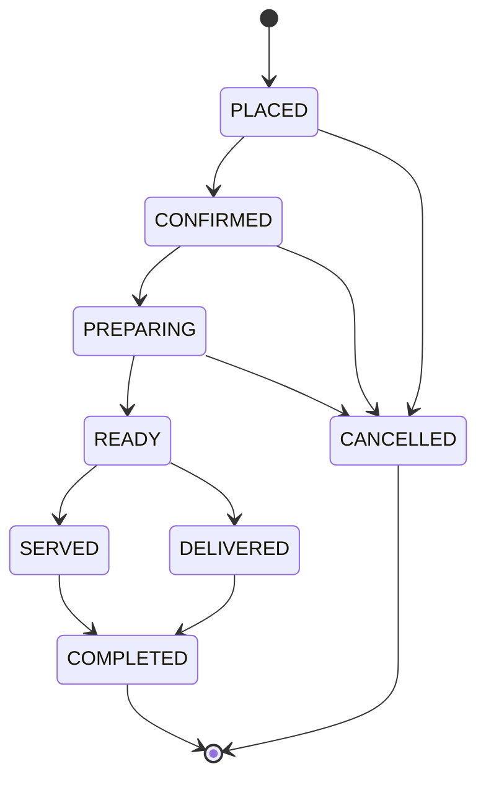

# Module 2 - Restaurant ERP

**Reuse assessment and delivery plan**

Prepared for Golden Hills Resort by QuantumCLK Technologies

---

## Document control

| Item | Detail |
|---|---|
| Document | Module 2 - Restaurant ERP: reuse assessment and delivery plan |
| Version | 0.1 - draft for approval |
| Date | 2026-10-20 |
| Owner | Project team |
| Audience | Client approver, product owner, engineering team |
| Classification | Confidential |
| Status | Proposed. No build starts until this plan and CR-001 are approved. |

**Purpose.** Define how the restaurant product exposed by the `billzova-web` reference can become **Module 2 - Restaurant ERP** of the Golden Hills ERP, what is reused, what is rebuilt, what is excluded, and how it is delivered without destabilising the core resort ERP.

**Source note.** `billzova-web` is a user-authorised internal technical reference. The user confirmed ownership and permission on 2026-10-20. It is not a client requirements source under Rule 1. All client scope still comes from the SOW and approved Change Requests. The reference is recorded in the DEVLOG.

---

## Executive summary

The restaurant product should be delivered as a **new top-level Module 2**, not as a renumbered core resort module and not as a second copy of ERP-11.

- **Module 1** is the existing Golden Hills Resort ERP. Its SOW modules ERP-01 to ERP-14 are submodules.
- **Module 2** is the Restaurant ERP. It owns menu, tables, orders, kitchen display, QR ordering and restaurant administration.
- Module 2 is the **productised implementation of the SOW ERP-11 intent**, delivered behind a feature flag. ERP-11 is not built twice.
- Module 2 integrates with Module 1 for guest identity, room and stay context, folio posting, payments, RBAC, audit and reporting.

**Reuse verdict.** Billzova is a useful UX and domain reference, not a codebase to graft in. It is a frontend-only demo (78 files, about 15,400 lines) with a local mock store, no backend, no LICENSE file, and a different UI stack (Tailwind and React Router). The resort ERP uses a custom CSS React shell with no router. The plan therefore reuses **flows, screen patterns and data concepts**, and rebuilds the product in the existing stack.

**Recommendation.** Approve this plan and CR-001 as a **proposed** scope. Build Module 2 only after the Phase 3 core baseline is stable and the client confirms the add-on commercially. Start with the MVP covering menu, tables, orders, kitchen, QR ordering and folio posting. Defer inventory, waste, staff, expenses and advanced reports until a separate change request.

**Indicative effort.** 31 to 44 developer-days for the full plan, including tests and documentation. The MVP is 28 to 40 developer-days.

---

## 1. Module hierarchy

### 1.1 Agreed hierarchy

| Level | Scope | Examples |
|---|---|---|
| **Module 1** | Golden Hills Resort ERP, the existing product | Booking, front office, guest CRM, membership, billing, reporting |
| Module 1 submodules | SOW modules ERP-01 to ERP-14 plus facilities, housekeeping and maintenance | ERP-02 Booking, ERP-03 Front Office, ERP-07 Billing |
| **Module 2** | Restaurant ERP, a separately flaggable product module | Menu, tables, orders, kitchen, QR menu |
| Module 2 submodules | R-01 to R-08 | R-01 Menu and Catalog, R-03 Orders, R-04 Kitchen Display |

### 1.2 What changes

- The restaurant becomes a first-class product module with its own submodule numbering (R-01 to R-08).
- Module 2 owns its domain data and screens.
- Module 2 is enabled by configuration and role, not by editing Module 1 code paths.
- The SOW ERP-11 optional add-on is implemented through Module 2, not separately.

### 1.3 What does not change

- Existing ERP-02 Booking remains the room booking module. It is not renamed or replaced.
- Existing ERP-07 Billing remains the only owner of folio settlement, invoices, payments and refunds.
- Existing ERP-04 Guest CRM remains the owner of guest identity.
- Existing ERP-08 owns RBAC, audit, configuration and reporting infrastructure.
- Module 2 cannot write directly into Module 1 tables. It calls Module 1 services.

### 1.4 Scope gate

Module 2 is outside the CORE MVP baseline confirmed on 2026-10-09 (Q-005). It therefore requires:

1. A proposed Change Request, CR-001.
2. Client confirmation that the add-on is wanted.
3. A feature flag, default off.
4. An approved plan and a separate build approval.

This document satisfies the planning step only. It is not a build approval.

---

## 2. Source assessment: billzova-web

### 2.1 What the reference is

| Attribute | Finding |
|---|---|
| Product type | Restaurant management dashboard, not a full POS |
| Frontend | React 19, TypeScript 6, Vite 8, Tailwind 4, React Router 7, lucide-react, socket.io-client |
| Backend | None in the reference |
| Persistence | Local mock store, about 2,200 lines, plus partial live API wrappers |
| Repository | Not a git repository at the time of review |
| Licensing | No LICENSE file. The package is private. The user confirmed internal ownership and permission on 2026-10-20. |
| Feature depth | Broad, but several pages are demos, upsell stubs or simulated flows |
| POS boundary | The POS is external. The reference links out to a POS URL. |

### 2.2 Reuse verdict

| Area | Verdict | Reason |
|---|---|---|
| Information architecture | Reuse as reference | The navigation and screen grouping are useful for a restaurant back office |
| Domain model | Reuse concepts | Menu, add-ons, tables, orders, kitchen statuses and line snapshots are sound |
| UI patterns | Reuse selectively | Cards, filters, status badges, drawers and kitchen cards fit the existing design language |
| React code | Rebuild | Tailwind, React Router and socket.io do not match the resort ERP stack |
| Backend and API | Rebuild | No backend exists; all money, state and audit rules must be ours |
| Mock data | Do not ship | Seed data must be labelled and owned by our backend |
| AI, chat, WhatsApp, subscription, branches | Discard for Module 2 MVP | Outside ERP-11 scope or not contracted |
| Inventory, waste, staff, expenses | Defer | Useful later, but not in the ERP-11 SOW |

---

## 3. Feature assessment

The matrix classifies each reference area. "Rebuild" means the flow is in scope but the implementation is new. "Pattern" means only the layout or interaction idea is reused. "Defer" means a future change request is required. "Discard" means it is not part of Module 2.

| Feature in the reference | Verdict | Module 2 treatment |
|---|---|---|
| Menu management: categories, items, variants, add-ons, tax, availability | Rebuild | R-01, core MVP |
| Tables and floors with statuses | Rebuild | R-02, core MVP; use dining tables, not room statuses |
| Orders, filters, date range, detail view | Rebuild | R-03, core MVP |
| Kitchen order board and status updates | Rebuild | R-04, core MVP |
| QR and digital menu | Rebuild | R-05, MVP with signed table token |
| Room service tied to guest and room | Rebuild | R-03 plus Module 1 stay lookup |
| Order posting to guest folio | Rebuild | R-06, idempotent integration with ERP-07 |
| Order dashboard and sales snapshot | Pattern | Basic KPIs in R-07; reuse visual ideas only |
| Customers | Pattern | ERP-04 already owns guests; no duplicate customer master |
| Payments, expenses, deleted invoices | Pattern | ERP-07 owns payments; expenses are out of scope |
| Sales, billing, item and GST reports | Pattern | Module 1 reporting owns reports; restaurant-specific sales summary only |
| Menu CSV import | Defer | Useful second-phase feature; implement server-side |
| Menu scan and AI import | Discard | External AI dependency and no SOW requirement |
| Inventory and purchase orders | Defer | Not in ERP-11; separate change request |
| Waste tracking | Defer | Not in ERP-11; separate change request |
| Staff, departments and shifts | Discard for Module 2 | ERP-14 HRMS add-on |
| Settings: tax, hours, bill design, notifications | Pattern | Only restaurant settings in R-08; rest belongs to ERP-08 |
| WhatsApp log and templates | Discard | ERP-12 add-on |
| Chat, support and Zova suggestions | Discard | Not in SOW |
| Subscription, branches, commission, collaboration | Discard | Commercial upsell stubs in the reference, not product scope |
| Online ordering, delivery and pincodes | Discard | Not in ERP-11; POS and delivery are external |
| Developers and API keys page | Discard | No SOW requirement; security risk |
| POS link-out | Discard | The resort ERP is not a POS and will not become one |

### 3.1 What is genuinely valuable

1. **The menu model.** Categories, variants, add-on groups and per-item tax are the right shape for an Indian resort restaurant.
2. **The order lifecycle.** The reference's draft-to-served flow maps cleanly to the SOW workflow: guest, menu, order, kitchen, preparing, ready, delivery, billing.
3. **The kitchen board.** Large status cards with elapsed time and one-tap transitions are the right operator experience.
4. **The table view.** Floor grouping and table status are useful, provided they remain separate from room housekeeping status.
5. **The settings checklist.** Tax, service hours, order types and QR settings are a useful completeness list.

### 3.2 What must not be copied

- The mock store as a source of truth.
- Client-side money calculations as the authority.
- Simulated imports or AI results presented as real.
- Any wrapped third-party asset without a licence check.
- The Tailwind and React Router stack without an architecture decision.

---

## 4. Scope

### 4.1 MVP scope

The MVP proves the complete restaurant loop on one property and one or more outlets:

- R-01: menu categories, items, variants, add-on groups, tax, availability.
- R-02: floors and dining tables, table status.
- R-03: dine-in, room-service and takeaway orders, with line price snapshots.
- R-04: kitchen display, status transitions and elapsed time.
- R-05: public QR menu with a signed table token and guest order creation.
- R-06: post a completed order to the guest folio exactly once.
- R-08: minimum settings for outlets, service hours, tax, order types and QR base URL.
- RBAC, audit events, idempotency, pagination and error handling.
- Seed data and a documented demo path.
- Backend tests, web build and manual smoke test.

### 4.2 Deferred scope

These items are useful but require a separate change request:

- Menu CSV import.
- Inventory, purchase orders, stock movements and stock counts.
- Waste tracking.
- Staff, departments, shifts and attendance.
- Expenses and deleted-invoice workflows.
- Advanced sales, item and tax reports.
- Multi-outlet analytics.
- Loyalty earn and redeem inside the restaurant flow, beyond existing Module 1 membership integration.

### 4.3 Out of scope

- Full standalone POS, cash drawer, fiscal printer and offline POS.
- Online delivery marketplace integration.
- WhatsApp automation, marketing campaigns and chat.
- Payroll, statutory HR and full HRMS.
- Subscription billing and branch franchising.
- External accounting integration.
- AI menu scanning.
- Any feature that requires a new third-party paid service without approval.

---

## 5. Architecture

### 5.1 Deployment shape

Start as a **modular monolith** inside the existing Spring Boot application:

- New bounded context package: `com.quantumclk.erp.restaurant`.
- New Flyway migration for restaurant tables.
- Same PostgreSQL database, same Keycloak realm, same audit and RBAC foundation.
- Same React application shell, with a role-gated Restaurant group.
- A separate public entry point for the QR menu.

Why: Module 2 needs transactional access to guest, stay and folio data. A separate service would add distributed transactions and operational overhead for a single-property resort. The package boundary keeps the option to extract Module 2 later if it is sold as a standalone product.

### 5.2 Bounded contexts and data ownership

| Data | Owner | Module 2 access |
|---|---|---|
| Guest profile | Module 1, ERP-04 | Read through a service interface |
| Reservation and stay | Module 1, ERP-02/03 | Read room and stay context |
| Folio, payment, invoice | Module 1, ERP-07 | Append a folio entry through the folio service |
| User, role, audit | Module 1, ERP-08 | Use existing auth and audit writers |
| Menu, tables, orders, kitchen | Module 2 | Full ownership |
| Restaurant settings | Module 2, stored as configuration | Read and write restaurant keys only |

No Module 2 repository may query Module 1 tables directly. Cross-context calls go through services. This keeps the boundary testable and prevents a future extraction from becoming a rewrite.

### 5.3 Proposed data model

| Table | Key fields |
|---|---|
| `restaurant_outlet` | id, property_id, name, type, service_hours, active |
| `dining_table` | id, outlet_id, code, floor, capacity, status, qr_token_version |
| `menu_category` | id, outlet_id, name, sort_order, active |
| `menu_item` | id, outlet_id, category_id, name, description, base_price_paise, tax_code, available, sort_order |
| `menu_variant` | id, item_id, name, price_delta_paise, active |
| `menu_addon_group` | id, item_id, name, min_select, max_select |
| `menu_addon_option` | id, group_id, name, price_paise, active |
| `restaurant_order` | id, property_id, outlet_id, table_id, stay_id, guest_id, order_type, status, subtotal_paise, tax_paise, total_paise, idempotency_key, folio_entry_id, created_by |
| `restaurant_order_line` | id, order_id, item_id, name_snapshot, variant_snapshot, quantity, unit_price_paise, tax_paise, line_total_paise, notes |
| `restaurant_order_event` | id, order_id, from_status, to_status, actor, reason, at |

All tables carry `property_id` where appropriate, use paise integers, store time in UTC and write audit fields. Order lines snapshot names and prices so later menu edits cannot rewrite history.

### 5.4 Order state machine

Rules:

- Only kitchen and restaurant-manager roles may move an order to PREPARING, READY or DELIVERED.
- Only restaurant staff or managers may create, serve or complete an order.
- Cancellation requires a reason. Cancellation after PREPARING requires a manager.
- Illegal transitions return a conflict error and are never silently ignored.
- Every transition writes an append-only event with actor and timestamp.

### 5.5 API contract

Proposed base path: `/api/v1/restaurant`.

| Area | Endpoints |
|---|---|
| Menu | `GET/POST /menu/categories`, `GET/POST/PATCH /menu/items` |
| Tables | `GET/POST/PATCH /tables`, `POST /tables/{id}/status` |
| Orders | `POST /orders` with idempotency key, `GET /orders`, `GET /orders/{id}`, `POST /orders/{id}/status` |
| Kitchen | `GET /kitchen/queue?outlet=&status=` |
| Folio | `POST /orders/{id}/post-to-folio` with idempotency key |
| Reports | `GET /reports/sales`, `GET /reports/items` |
| Settings | `GET/PATCH /settings` for restaurant keys only |
| Public QR | `GET /api/v1/public/restaurant/menu`, `POST /api/v1/public/restaurant/orders` |

All list endpoints use pagination and a bounded `size`. All writes use the standard error envelope and request ID. Public QR endpoints are rate-limited and do not expose staff data or guest PII.

### 5.6 Frontend

- Keep the existing React shell and custom CSS.
- Add a role-gated **Restaurant** navigation group: Menu, Tables, Orders, Kitchen, Reports, Settings.
- Reuse visual patterns from the reference, not its Tailwind classes or router.
- Add shared primitives only when at least two screens need them: status badge, filter bar, empty state, drawer, confirm dialog.
- No new frontend dependency without an ADR. This excludes Tailwind, React Router, lucide-react and socket.io for this module.
- Kitchen display must work on a wall-mounted screen with large touch targets and no hover-only actions.

### 5.7 Public QR menu

The QR menu is the only unauthenticated surface. It must be isolated:

- A separate Vite entry, for example `menu.html`, with its own small bundle.
- No staff token in the public bundle.
- A signed table token containing outlet and table identifiers and a version.
- Server-side validation of the token, table status and outlet availability.
- Rate limiting and request-size limits on public order creation.
- No guest PII in URL parameters.
- The public page is read-only for menu browsing and creates an order only after explicit confirmation.

### 5.8 Realtime

The current backend has no WebSocket dependency. The MVP uses **short polling**:

- Kitchen queue and order list poll every 5 seconds while visible.
- Requests carry an `updatedSince` parameter to avoid full refreshes.
- Polling stops when the tab is hidden.
- Server-Sent Events can replace polling later if the load requires it. That is an ADR-level change, not an MVP dependency.

### 5.9 Security and audit

- Reuse Keycloak authentication and the existing RBAC foundation.
- Add restaurant roles: `RESTAURANT_ADMIN`, `RESTAURANT_MANAGER`, `RESTAURANT_STAFF`, `KITCHEN`.
- Deny by default. Every controller method states its required permission.
- Audit menu price changes, availability changes, order status changes, cancellations and folio postings.
- Log actor, timestamp, object, before and after, reason and request ID.
- Never trust client-calculated totals. Recompute prices and tax on the server.
- Do not expose public order endpoints to staff data.

### 5.10 Money and tax

- Store money as integer paise. Never use floating point.
- Store the tax code and rate snapshot on each order line.
- Recompute subtotal, tax and total on the server at order creation.
- Post the final amount to the folio as a single entry with `source_type = RESTAURANT_ORDER`.
- Reversal is a new credit entry, never an edit.
- Tax rates and service charge are configuration, not hard-coded business rules.

---

## 6. Submodule plan

| ID | Submodule | MVP | Depends on |
|---|---|---|---|
| M2.0 | Foundation, change request, feature flag, design package | Yes | Approval of this plan |
| R-01 | Menu and Catalog | Yes | M2.0 |
| R-02 | Tables and Floors | Yes | R-01 |
| R-03 | Orders | Yes | R-01, R-02 |
| R-04 | Kitchen Display | Yes | R-03 |
| R-05 | QR and Digital Menu | Yes | R-01, R-03 |
| R-06 | Billing and Folio | Yes | R-03, ERP-07 |
| R-07 | Reports and Administration | Later | R-03, ERP-08 |
| R-08 | Restaurant Settings | Yes, minimum | M2.0 |

### R-01 Menu and Catalog

Categories, items, descriptions, prices, variants, add-on groups, tax codes and availability. Admin screens support search, filters, ordering and bulk availability toggles. Item deletion is soft. Price changes are audited. Public menu reads only available items.

### R-02 Tables and Floors

Floors, table codes, capacity and status. Statuses are restaurant-specific: FREE, OCCUPIED, RESERVED, CLEANING. They do not reuse room housekeeping statuses. Table status changes are audited. QR token version is stored per table.

### R-03 Orders

Dine-in, room-service and takeaway orders. Room-service orders require an active stay or an explicit guest link. Orders snapshot line prices and names. Staff can add notes, split items by course later, and cancel with a reason. The order list filters by outlet, status, type and date.

### R-04 Kitchen Display

A queue per outlet with large cards, item counts, elapsed time and one-tap status changes. No mouse-only actions. New orders appear within the polling interval. The display shows cancellation and hold reasons clearly.

### R-05 QR and Digital Menu

Public mobile page for menu browsing and order creation. The QR encodes a signed table token. The page shows outlet name, table code, categories, item details, availability and taxes. Order confirmation is explicit. Public requests are rate-limited.

### R-06 Billing and Folio

A completed order can be posted to the guest folio once. The posting is idempotent: retries return the same folio entry. The folio entry stores the order ID, amount, tax and actor. The restaurant does not create invoices, capture payments or issue refunds; ERP-07 owns those actions.

### R-07 Reports and Administration

Restaurant sales summary, item mix, order counts and cancellation reasons. Reports use Module 1 reporting and export infrastructure where available. If ERP-08 reporting is not ready, ship a read-only CSV export and mark the richer reports as pending. Do not build a parallel reporting stack.

### R-08 Restaurant Settings

Outlet name and type, service hours, order types, tax codes, service charge, QR base URL and table token version. Settings are stored as configuration with audit. Do not expose unrelated Module 1 configuration.

---

## 7. Integration with Module 1

| Integration | Direction | Contract |
|---|---|---|
| Guest lookup | Module 2 reads Module 1 | Guest service returns a safe summary; no direct table access |
| Stay and room context | Module 2 reads Module 1 | Active stay lookup by stay or room; used for room service |
| Folio posting | Module 2 writes through Module 1 | Folio service appends one entry per order, idempotent |
| Payments | Module 1 owns | Restaurant never captures or refunds directly |
| RBAC | Shared | Restaurant roles and permissions added to the existing model |
| Audit | Shared | Restaurant events use the existing append-only audit writer |
| Reporting | Module 1 owns | Restaurant contributes data through its own API or reporting view |
| Configuration | Shared framework | Restaurant keys are namespaced and audited |

Failure rules:

- If the folio service is unavailable, the order remains completed but is marked `folio_pending`. A retry job or manual action can post it later.
- If the stay ends before a room-service order is delivered, the order still posts to the guest folio if the stay is open; otherwise it is flagged for manager review.
- No integration failure may silently lose a charge. The UI shows the pending state and the reason.

---

## 8. Delivery roadmap

### 8.1 Work packages and estimates

| Work package | Deliverable | Dev-days |
|---|---|---|
| M2.0 | CR, flag, design package, ADR, schema, API contract, screens | 3 to 4 |
| R-01 | Menu and catalog backend and admin UI | 4 to 6 |
| R-02 | Tables and floors backend and UI | 2 to 3 |
| R-03 | Orders backend, state machine and UI | 5 to 7 |
| R-04 | Kitchen queue and display | 3 to 4 |
| R-05 | Public QR menu and signed token | 3 to 5 |
| R-06 | Folio integration and retry handling | 2 to 3 |
| R-07 | Reports and administration | 3 to 4 |
| R-08 | Restaurant settings | 2 to 3 |
| Hardening | Tests, docs, traceability, seed data, UAT prep | 4 to 5 |
| **Total** | Full plan | **31 to 44** |

The MVP includes M2.0, R-01 to R-06, the minimum R-08 settings and hardening: **28 to 40 developer-days**. R-07 reports and administration bring the full plan to **31 to 44 developer-days**. A single full-stack developer should plan for 7 to 9 weeks for the full plan, or 6 to 8 weeks for the MVP, allowing for review and UAT.

### 8.2 Sequence and gates

1. **Gate 0 - Scope.** Approve this plan, CR-001 and the client add-on confirmation. Create the feature flag. No code.
2. **Gate 1 - Design.** Produce the detailed data model, API contract, screen flows and ADRs for the public QR surface and polling. Review with the user.
3. **Gate 2 - Menu and tables.** Demo R-01 and R-02 on seed data. Verify RBAC and audit.
4. **Gate 3 - Order loop.** Demo order creation, kitchen transitions and cancellation. Verify state and money tests.
5. **Gate 4 - Guest loop.** Demo QR menu, room service and folio posting. Verify idempotency and pending-folio handling.
6. **Gate 5 - Hardening.** Full test suite, web build, docs, traceability and UAT script. Present for approval.
7. **Gate 6 - Release.** Only after Module 1 core is stable and the client signs off.

### 8.3 Dependency on current work

Module 2 planning can proceed now. Module 2 build should not start until:

- The uncommitted 3.8 dashboard work is committed or otherwise resolved.
- Phase 3 core exit is approved.
- ERP-07 folio behaviour is stable.
- The Module 2 feature flag and CR are approved.

---

## 9. Testing and acceptance

### 9.1 Backend tests

- Menu CRUD, soft delete, availability and price history.
- Table status transitions and invalid transitions.
- Order creation with variants and add-ons; server-side totals.
- Idempotent order creation and folio posting.
- Full state machine, including forbidden transitions and cancellation rules.
- RBAC for every restaurant endpoint.
- Public QR token validation, expired token, wrong outlet and rate limit.
- Room-service order requires a valid stay or guest link.
- Folio entry created once, retry returns the same entry.
- Pagination, filtering and error shape.
- Audit event written for every write.

### 9.2 Frontend checks

- `npm run build` green.
- Menu, tables, orders and kitchen screens work on desktop and a wall-mounted kitchen viewport.
- Public QR page works on a phone viewport without staff login.
- No unauthenticated access to staff screens.
- Error, empty and loading states are visible and honest.
- No new dependency enters `package.json` without an ADR.

### 9.3 Acceptance criteria

The MVP is accepted when:

1. A guest scans a table QR, views the menu and places an order.
2. The kitchen sees the order within 5 seconds and moves it through preparing to ready.
3. Staff serve or deliver the order and complete it.
4. The order posts to the correct guest folio exactly once.
5. A second post attempt does not duplicate the charge.
6. A manager can cancel an order with a reason, and the audit trail shows it.
7. A user without a restaurant role cannot see or call restaurant screens.
8. `mvn -B verify` and `npm run build` are green.
9. The module doc, API doc, traceability rows and runbook are updated.

---

## 10. Risks and mitigations

| Risk | Impact | Mitigation |
|---|---|---|
| Scope creep from the broad reference | High | MVP list is fixed. Inventory, waste, staff, expenses and advanced reports need a CR. |
| Reference code does not match our stack | Medium | Reference-first policy. Rebuild flows and patterns. No Tailwind, router or socket.io. |
| Public QR abuse | High | Signed table token, rate limits, server validation and no PII in URLs. |
| Duplicate folio charge | High | Idempotency key, unique order source and a full-stack test. |
| Tax or rounding error | High | Server-side paise arithmetic, tax snapshots and tests. No hard-coded rates. |
| Kitchen display expectations exceed polling | Medium | 5-second polling in MVP. SSE is a later ADR. |
| Module boundary erosion | Medium | Service interfaces only. No cross-context repository access. |
| Optional add-on is not contracted | High | CR-001, Q-012 and client confirmation before build. |
| Third-party assets inside the reference | Medium | Licence review before copying any image, font or asset. Prefer original or client-supplied assets. |
| Core ERP work is destabilised | High | Module 2 starts after Phase 3 exit and behind a feature flag. |

---

## 11. Governance

### 11.1 Change control

- CR-001 records Module 2 as a proposed scope change.
- Q-012 records the client confirmation gate.
- The feature flag is `module.restaurant.enabled`, default `false`.
- No production data is used in development.
- No client raw files or credentials enter the repository.

### 11.2 Approval gates

| Gate | What is approved | Who |
|---|---|---|
| Plan | This document and the module hierarchy | Client approver and project owner |
| Design | Detailed schema, API, screens and ADRs | Project owner and engineering lead |
| Slice demos | Each work package against acceptance criteria | Project owner |
| UAT | End-to-end restaurant loop | Client operations representative |
| Release | Feature flag enabled in production | Client approver |

### 11.3 Commit policy

This plan is a documentation artifact. It is not committed automatically. A commit requires explicit approval after review.

---

## 12. Decisions requested

Please approve or amend the following:

1. **Module hierarchy.** Module 1 is the resort ERP; Module 2 is the Restaurant ERP; R-01 to R-08 are its submodules.
2. **Reuse policy.** Billzova is a reference. Module 2 is rebuilt in the existing React and Spring Boot stack. No Tailwind, React Router or socket.io.
3. **Architecture.** Modular monolith, restaurant bounded context, shared guest, folio, RBAC and audit services, public QR entry, polling-first realtime.
4. **MVP scope.** Menu, tables, orders, kitchen, QR menu, folio posting and minimum settings. Deferred items require a separate CR.
5. **Commercial gate.** CR-001 is proposed. The client must confirm the add-on before build.
6. **Next step.** After this plan is approved, produce the detailed design package (schema, API, screens, ADRs) or proceed to build after Phase 3 exit. Both require a separate approval.

---

## Appendix A - Reference surface inventory

| Reference page | Lines | Relevance to Module 2 |
|---|---:|---|
| Menu | 916 | High - core menu model and editor |
| Inventory | 690 | Deferred - not in ERP-11 |
| Staff | 521 | Out - ERP-14 HRMS |
| Subscription | 470 | Discard |
| Tables | 434 | High - floor and table experience |
| Menu Import | 423 | Deferred - CSV import later |
| Chat | 400 | Discard |
| Waste | 400 | Deferred - separate CR |
| GST return 3B | 386 | Pattern only - ERP-08 reporting |
| Expenses | 337 | Deferred - out of scope |
| Customers | 317 | Pattern only - ERP-04 owns guests |
| GST return 1 | 290 | Pattern only - ERP-08 reporting |
| Dashboard | 268 | Pattern - KPI and chart ideas |
| Item report | 264 | Pattern - R-07 later |
| Orders | 250 | High - order list and detail |
| Help | 226 | Discard |
| Menu Scan | 219 | Discard - AI dependency |
| Deleted invoices | 199 | Discard - Module 1 billing |
| Reports index | 193 | Pattern only |
| Settings | 190 | Pattern - settings taxonomy |
| Sales report | 184 | Pattern - R-07 later |
| Billing report | 150 | Pattern - Module 1 billing |
| Payments | 110 | Pattern - ERP-07 owns payments |
| WhatsApp log | 90 | Discard - ERP-12 |

The reference also contains layout, notification, chat, theme and mock-store code. None of that is a Module 2 deliverable.

---

## Appendix B - Glossary

| Term | Meaning |
|---|---|
| Module 1 | The Golden Hills Resort ERP core product |
| Module 2 | The Restaurant ERP product described here |
| ERP-11 | The SOW optional add-on for digital dining and kitchen management |
| Outlet | A restaurant, bar, cafe or room-service kitchen |
| Cover | A seated guest counted for table capacity |
| KOT | Kitchen order ticket, the kitchen's working copy of an order |
| Folio | The guest's running account, owned by Module 1 billing |
| Paise | The smallest Indian currency unit; all money is stored as integers |
| QR token | A signed token that identifies an outlet and table for the public menu |

---

## Approval

| Role | Name | Decision | Date |
|---|---|---|---|
| Client approver |  | Approve / Amend / Reject |  |
| Project owner |  | Approve / Amend / Reject |  |
| Engineering lead |  | Approve / Amend / Reject |  |

**Approval note.** Approval of this document authorises the plan and CR-001 as a proposed scope. It does not authorise code, dependency changes, schema migrations or a production release. Those require the separate gates above.

### On approval

The following actions are authorised once this document is signed:

1. Record CR-001 as approved in `docs/01-requirements/CHANGE_REQUESTS.md`.
2. Close Q-012 with the client's Module 2 add-on confirmation.
3. Create the `module.restaurant.enabled` feature flag, disabled in every environment.
4. Schedule Gate 1 and produce the design package for review.
5. Leave Phase 3 work unit 3.8 and the CORE baseline unchanged until Phase 3 exit.

### Document history

| Version | Date | Author | Change |
|---|---|---|---|
| 0.1 | 2026-10-20 | Project team | Initial plan for client approval |

*End of document.*
